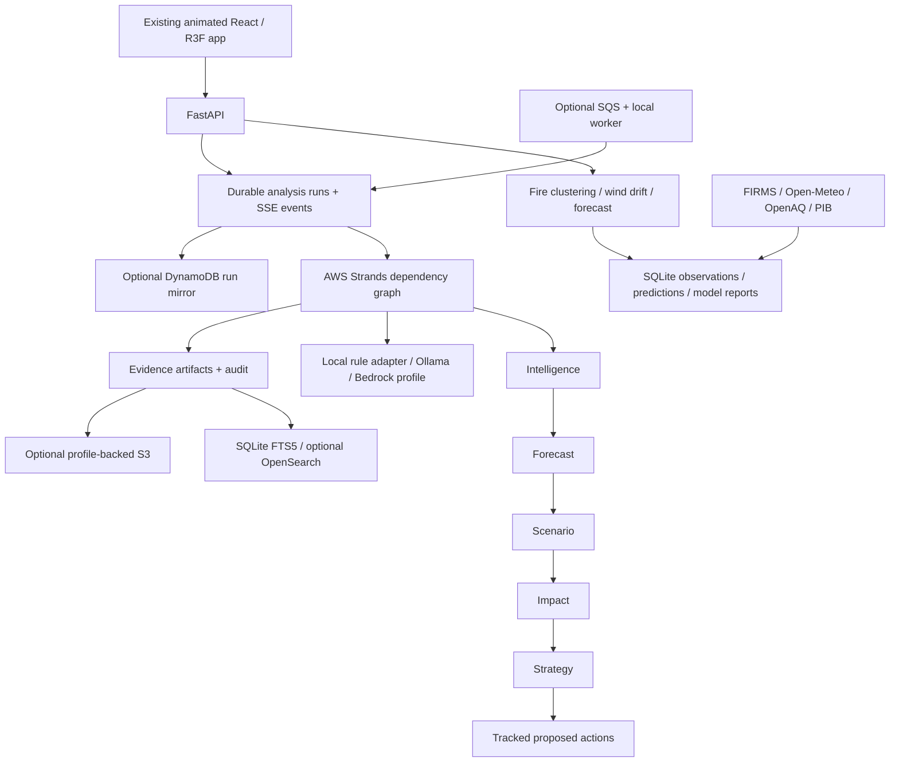

# Atmos architecture

## Reference and scope

PRISM.ai's repository documents a digital twin with specialist orchestration, autonomous data feeds, persistent forecasts, agent traces, audit logs, cooldowns and strategy tracking. Atmos adapts those patterns to fire-to-city transport. It uses AWS Strands instead of Google ADK and forecasts PM2.5 instead of supply-chain risk. This is a substantive local research application, not a claim of PRISM's deployment scale or production readiness.

## Boundaries

- Data providers normalize timestamps, retain provenance and report failures. Demo observations are partitioned from live records.
- Transport is deterministic, with DBSCAN cluster nodes and integrated hourly wind-drift edges. The graph's score is not calibrated smoke probability.
- Forecasts are trained/evaluated with chronological selection, calibration and held-out test sets. Persistence remains the honest fallback.
- Chat uses Strands agents as tools for routed questions. Full city analysis uses an actual five-node Strands Graph with explicit dependencies and execution limits.
- Specialists read a consistent run snapshot. Only tool outputs become returned quantitative evidence; generated prose cannot manufacture measurements.
- Each graph execution has its own Strands file session. UI sessions group saved analyses; they are not unrestricted LLM memory or a source of current measurements.
- SQLite atomically claims queued analyses to prevent duplicate execution. The current worker/API share one local database; DynamoDB is a metadata mirror, not a distributed scheduler.
- Run status, tool start/completion events, durations, artifacts, proposed actions and audit events are durable. Unfinished work becomes interrupted on restart rather than silently replaying cloud calls.
- Alerts use freshness, validation/coverage, severity and transport gates. Demo/scenario outputs cannot send external alerts.

## Operational limits

The app runs on localhost. The SDK adapters support a named AWS profile, but resources/model access require real account setup. No hosted website, cloud deployment, automatic IAM changes or measured multi-user throughput is claimed. OpenSearch and SAM are optional integrations requiring their runtimes. A single local SQLite worker is deliberately described as such; production scaling would require shared durable storage, authentication, authorization, worker leases and load evaluation.

## Hackathon demo flow

1. Show the preserved cloud/window opening and flowing smoke interlude.
2. Select Delhi in the twin and inspect source detections, wind paths and station PM2.5.
3. Change wind/fire controls and compare computed paths/results; disclose demo mode.
4. Run a complete city analysis and show five Strands specialist evidence events.
5. Open the persistent evidence library and tracked action plan.
6. Show model comparisons and arrival hits/misses; state synthetic versus real validation.
7. Show exactly where Strands and the chosen AWS services run. Do not claim cloud services are connected unless the connection check succeeded.

The event asks for a three-minute recorded demo. Source: [official Environmental Hacks page](https://www.wemakedevs.org/aws/env). Reference architecture: [PRISM.ai repository](https://github.com/harshbpathak/prism.ai).
